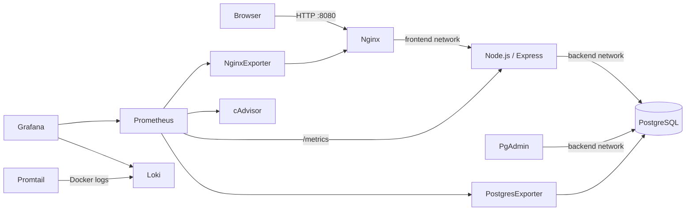

# Đề 12 — Hệ thống Quản lý Nhà hàng / Order

Ứng dụng Node.js/Express quản lý món ăn, bàn và đơn hàng, triển khai hoàn toàn bằng Docker Compose. PostgreSQL lưu dữ liệu; Nginx là reverse proxy; Prometheus/Grafana theo dõi metrics; Loki/Promtail tập trung log; pgAdmin quản trị cơ sở dữ liệu.

## Kiến trúc



Các network được tách theo mục đích. `backend` và `monitoring` là network nội bộ; `management` kết nối pgAdmin, Prometheus và Grafana để các cổng quản trị/quan sát được publish đúng cách, nhưng chỉ bind vào `127.0.0.1`. Website được công bố riêng qua Nginx. PostgreSQL không publish cổng ra host.

## Yêu cầu

- Docker Desktop/Engine có Docker Compose v2 (`docker compose`).
- Git.
- Với máy Windows: Docker Desktop chạy Linux containers; thư mục dự án đặt trên ổ đĩa được Docker Desktop chia sẻ.

## Cấu hình mật khẩu

Không dùng mật khẩu trong `.env.example` ở môi trường thật. Tạo `.env` riêng và thay mỗi biến `REPLACE_WITH...` bằng một secret **riêng biệt**, ngẫu nhiên, tối thiểu 24 ký tự. Ví dụ tạo chuỗi bằng PowerShell:

```powershell
$bytes = New-Object byte[] 32
[Security.Cryptography.RandomNumberGenerator]::Create().GetBytes($bytes)
[BitConverter]::ToString($bytes).Replace('-', '').ToLowerInvariant()
```

Chạy ba dòng trên trong PowerShell để tạo chuỗi mật khẩu ngẫu nhiên mật mã học; lặp lại cho PostgreSQL admin, ứng dụng, exporter, pgAdmin và Grafana. Không commit `.env`; `.gitignore` đã loại trừ file này.

```powershell
Copy-Item .env.example .env
notepad .env
```

Trên Linux/macOS có thể dùng `cp .env.example .env` và `openssl rand -hex 32` để tạo từng secret.

## Khởi chạy

Từ thư mục gốc dự án:

```powershell
docker compose config
docker compose up -d --build
docker compose ps
```

Compose sẽ đợi PostgreSQL healthy trước khi khởi động ứng dụng và pgAdmin. Dữ liệu được lưu trong named volumes, không mất khi chỉ chạy `docker compose down`.

| Thành phần | Địa chỉ mặc định | Ghi chú |
|---|---|---|
| Website | <http://localhost:8080> | Đi qua Nginx; không truy cập trực tiếp app |
| pgAdmin | <http://localhost:5050> | Email/mật khẩu lấy từ `.env`; server DB được khai báo trước |
| Grafana | <http://localhost:3001> | Tài khoản/mật khẩu lấy từ `.env`; dashboard đã provision |
| Prometheus | <http://localhost:9090> | Trang `Status → Targets` để kiểm tra scrape |
| PostgreSQL | Không publish host port | Chỉ truy cập nội bộ qua `db:5432` |
| Loki | Không publish host port | Được Grafana và Promtail truy cập nội bộ |

Các port trên chỉ bind vào loopback để tránh công khai giao diện quản trị. Nếu cần demo qua LAN, chỉ sửa địa chỉ bind sau khi đã giới hạn firewall và đặt xác thực/TLS phù hợp; không publish trực tiếp PostgreSQL hoặc Loki.

## Demo ứng dụng và database

1. Mở website, kiểm tra thực đơn, trạng thái bàn và đơn hàng được tải từ PostgreSQL qua các API `/api/menu`, `/api/tables`, `/api/orders`.
2. Chọn một bàn đang trống (hoặc “Không gắn với bàn”), nhấn **Tạo đơn hàng** trên một món. Đơn mới phải hiện trong danh sách và số liệu tổng quan; khi chọn bàn, trạng thái bàn chuyển sang “Đang phục vụ”.
3. Mở pgAdmin, đăng nhập bằng `PGADMIN_DEFAULT_EMAIL` và `PGADMIN_DEFAULT_PASSWORD`; chọn server **Restaurant PostgreSQL**. Khi kết nối lần đầu, nhập `DB_PASSWORD`. Role ứng dụng `restaurant_app` không phải superuser; exporter dùng role riêng `restaurant_metrics` có quyền `pg_monitor`.
4. Trong pgAdmin mở Query Tool và kiểm tra dữ liệu:

```sql
SELECT * FROM menu_items ORDER BY id;
SELECT * FROM restaurant_tables ORDER BY table_number;
SELECT id, table_id, status, total_amount, created_at
FROM orders ORDER BY created_at DESC;
```

## Monitoring: Prometheus + Grafana

Prometheus scrape theo chu kỳ 15 giây:

- `restaurant-app`: runtime Node.js từ `/metrics`.
- `nginx`: connections/requests qua `nginx-prometheus-exporter`.
- `postgres`: database/connection/transaction metrics qua `postgres-exporter`.
- `containers`: CPU và bộ nhớ container qua cAdvisor.

Nginx phục vụ website trên cổng 8080; endpoint `stub_status` chỉ lắng nghe cổng nội bộ 8081 để exporter đọc, không được publish ra host.

Mở Prometheus → **Status → Targets**; các target chính phải báo `UP`. Grafana → **Dashboards → Restaurant → Restaurant - System Overview** có biểu đồ container CPU/bộ nhớ, Nginx connections, PostgreSQL connections/transactions và access log. Datasource Prometheus/Loki cùng dashboard được tự động provision.

## Logging: Loki + Promtail + LogQL

Promtail phát hiện container Docker và đọc stdout/stderr từ Docker JSON log driver; giới hạn lưu log của từng container là 10 MB × 3 file. Grafana → **Explore** → datasource **Loki**, chạy một số truy vấn:

```logql
{service="nginx"}
```

```logql
{service="nginx"} | json | status >= 400
```

```logql
{service="app"} |= "Lỗi"
```

```logql
{container=~".*restaurant.*"} |~ "(?i)error|exception|fatal"
```

Các trường `service`/`container` được Promtail lấy từ metadata Docker/Compose. Nếu vừa khởi động, đợi vài giây để Promtail phát hiện container và sinh log; truy vấn chỉ trả dữ liệu trong khoảng thời gian đã chọn ở Grafana.

## Hardening được áp dụng

- Node.js chạy bằng user `appuser`; runtime app dùng filesystem chỉ đọc, bỏ toàn bộ Linux capabilities, bật `no-new-privileges`.
- PostgreSQL dùng role quản trị riêng để bootstrap; app và exporter có role tối thiểu riêng. Không publish cổng DB.
- Network phân vùng `frontend`, `backend`, `monitoring` và `management`; DB không có cổng host.
- Nginx chạy bằng image unprivileged trên cổng 8080, root filesystem chỉ đọc, giới hạn tốc độ API và thêm CSP, `X-Content-Type-Options`, `X-Frame-Options`, `Referrer-Policy`.
- Giao diện quản trị chỉ bind loopback mặc định; secret lấy từ `.env` không commit.
- Docker JSON logs có giới hạn xoay vòng.

**Lưu ý quyền telemetry:** cAdvisor cần quyền đọc thông tin host/container; cấu hình hiện dùng `privileged` để có số liệu container ổn định trên Linux. Promtail chạy UID 0 trong container và có mount Docker socket chỉ đọc để khám phá log. Socket Docker vẫn là bề mặt quyền nhạy cảm dù mount `:ro`; chỉ chạy stack này trên host tin cậy. Với production, thay collector bằng agent theo chính sách nền tảng và giới hạn quyền host.

pgAdmin chạy bằng user không-root `pgadmin`; không bật `no-new-privileges` cho service này vì entrypoint chính thức cần `sudo` trong bước khởi tạo. Giữ giao diện chỉ bind loopback và dùng mật khẩu mạnh.

Nginx hiện dùng HTTP nhưng có security headers theo yêu cầu. Nếu triển khai Internet, đặt TLS tại load balancer/reverse proxy tin cậy hoặc bổ sung chứng chỉ HTTPS và chỉ mở cổng TLS; không coi security headers là thay thế cho TLS.

## Vận hành và xử lý sự cố

```powershell
docker compose logs -f app
docker compose logs -f db
docker compose logs -f promtail loki
docker compose restart app
docker compose down
```

PostgreSQL chỉ tự chạy `database/init.sql` khi khởi tạo volume rỗng. Nếu đang giữ một volume cũ thiếu bảng/role, sau khi cấu hình `DB_USER` khác `POSTGRES_ADMIN_USER`, áp dụng script khởi tạo an toàn trên database hiện tại:

```powershell
docker compose exec -T db psql -U <POSTGRES_ADMIN_USER> -d <POSTGRES_DB> -v ON_ERROR_STOP=1 -f /docker-entrypoint-initdb.d/01-init.sql
docker compose up -d --build app postgres-exporter pgadmin
```

Thay `<POSTGRES_ADMIN_USER>` và `<POSTGRES_DB>` bằng giá trị trong `.env`. Script tạo/cập nhật role riêng và chỉ thêm dữ liệu mẫu còn thiếu; không xóa bảng hoặc order. Nếu đổi mật khẩu role sau khi volume đã khởi tạo, hãy áp dụng lại script bằng tài khoản quản trị để cập nhật role. Chỉ để tạo mới hoàn toàn dữ liệu demo mới chạy:

```powershell
docker compose down -v
docker compose up -d --build
```

Lệnh `down -v` xóa vĩnh viễn dữ liệu PostgreSQL, pgAdmin, Prometheus, Loki và Grafana; sao lưu trước nếu cần giữ dữ liệu. `docker compose down` không xóa dữ liệu.

## Repository và commit theo rubric

Tạo GitHub repository riêng theo mã số sinh viên, không đưa `.env`/secret lên GitHub. Nếu thư mục chưa có Git:

```powershell
git init
git add app database nginx pgadmin docker-compose.yml .env.example .gitignore
git commit -m "feat: deploy restaurant app with PostgreSQL and Nginx"
git add prometheus grafana
git commit -m "feat: add Prometheus and Grafana monitoring"
git add loki promtail
git commit -m "feat: centralize container logs with Loki and Promtail"
git add README.md report
git commit -m "docs: document deployment, security and demo"
git branch -M main
git remote add origin https://github.com/<ma-so-sinh-vien>/<repository>.git
git push -u origin main
```

Rubric yêu cầu ba commit chức năng đầu tiên; commit tài liệu/hardening là commit bổ sung có nội dung rõ ràng. Không dùng lệnh `git add .` trước khi kiểm tra `.env` chưa được stage.

## Báo cáo và minh chứng

Khung báo cáo ít nhất 10 trang, có trang bìa/placeholder thông tin sinh viên, sơ đồ kiến trúc, mô tả triển khai, kiểm thử và vị trí chèn ảnh chụp màn hình: [report/BAO-CAO.md](report/BAO-CAO.md). Thay các placeholder bằng thông tin thật và ảnh chụp khi stack chạy. Không sử dụng ảnh minh chứng giả.

## Cấu trúc chính

```text
app/                 Express app, API, UI, non-root Dockerfile
database/init.sql    Schema, dữ liệu mẫu, role DB giới hạn quyền
nginx/               Reverse proxy, security headers, rate limiting
pgadmin/             Cấu hình sẵn server PostgreSQL
prometheus/           Scrape targets
grafana/               Datasources và dashboard provision
loki/                  Cấu hình lưu log tập trung
promtail/              Thu thập Docker logs
docker-compose.yml     Toàn bộ stack và network/volume/healthcheck
report/BAO-CAO.md      Khung báo cáo môn học
```
