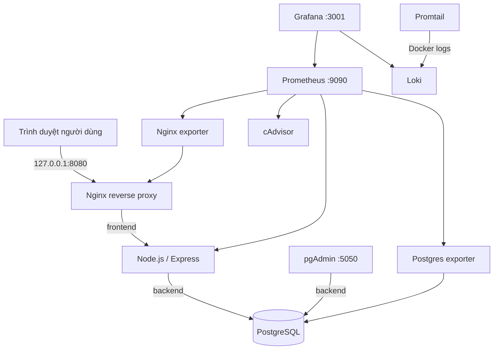

# BÁO CÁO THỰC HÀNH
## Triển khai và Quản trị Hệ thống Phần mềm

### Đề tài 12: Hệ thống Quản lý Nhà hàng / Order

**Sinh viên:** [Họ và tên]<br>
**Mã số sinh viên:** [MSSV — dùng làm tên tài khoản/repository GitHub]<br>
**Lớp:** [Tên lớp]<br>
**Giảng viên hướng dẫn:** [Họ và tên giảng viên]<br>
**Trường/Khoa:** [Tên trường / khoa]<br>
**Thời gian thực hiện:** [Tháng/năm]

> Khung nội dung được chia thành 11 trang dự kiến để hoàn thiện thành báo cáo tối thiểu 10 trang. Thay thông tin trong ngoặc vuông, kiểm tra lại số trang sau khi chuyển sang Word/PDF, và chèn ảnh chụp màn hình thật tại các vị trí đánh dấu. Không nộp các placeholder như minh chứng đã thực hiện.

<div style="page-break-after: always;"></div>

## Trang 1 — Bìa

**[TÊN TRƯỜNG]**<br>
**[TÊN KHOA / BỘ MÔN]**

<br><br>

### BÁO CÁO THỰC HÀNH
### MÔN: TRIỂN KHAI VÀ QUẢN TRỊ HỆ THỐNG PHẦN MỀM

<br>

## ĐỀ TÀI 12
## HỆ THỐNG QUẢN LÝ NHÀ HÀNG / ORDER

<br><br>

| Thông tin | Nội dung |
|---|---|
| Sinh viên thực hiện | [Họ tên] |
| Mã số sinh viên | [MSSV] |
| Lớp | [Lớp] |
| Giảng viên hướng dẫn | [Giảng viên] |
| Năm học | [Năm học] |

<br><br>

**[Tỉnh/Thành phố], [tháng/năm]**

<div style="page-break-after: always;"></div>

## Trang 2 — Lời mở đầu và mục tiêu

### 1. Lời mở đầu

Trong hoạt động nhà hàng, việc quản lý thực đơn, bàn ăn và đơn hàng cần cập nhật chính xác, nhất quán. Một ứng dụng web đơn giản có thể minh họa rõ cách giao diện, API và hệ quản trị cơ sở dữ liệu phối hợp với nhau. Tuy nhiên, một ứng dụng chạy được trên máy phát triển chưa đủ để vận hành có kiểm soát: cần đóng gói, cấu hình truy cập, giám sát tình trạng dịch vụ, lưu trữ log và hạn chế quyền.

Báo cáo này trình bày quá trình triển khai ứng dụng quản lý nhà hàng trên Docker Compose. Các thành phần được cấu hình trong repository để có thể khởi chạy lặp lại; trạng thái hoạt động được kiểm tra qua healthcheck, Prometheus và Grafana; log của các container được đưa tới Loki để truy vấn.

### 2. Mục tiêu

1. Đóng gói ứng dụng Node.js/Express và PostgreSQL trong Compose.
2. Truy cập giao diện qua Nginx reverse proxy; không publish cổng ứng dụng và database trực tiếp.
3. Có công cụ quản trị DB pgAdmin.
4. Thu thập metrics của ứng dụng, Nginx, PostgreSQL và container.
5. Tập trung log container bằng Loki/Promtail và thực hành LogQL.
6. Áp dụng biện pháp giảm bề mặt tấn công và ghi lại giới hạn còn tồn tại.
7. Lưu source/config trên GitHub, hướng dẫn chạy và chuẩn bị minh chứng demo.

### 3. Phạm vi

Đề tài là môi trường thực hành một host, một instance mỗi dịch vụ; không phải hệ thống HA hay nền tảng production. HTTPS chưa bật trong cấu hình mặc định; Nginx cung cấp security headers theo lựa chọn của đề bài. Khi triển khai công khai cần bổ sung TLS, firewall, quản lý secret và sao lưu.

<div style="page-break-after: always;"></div>

## Trang 3 — Yêu cầu và công nghệ

### 1. Yêu cầu chức năng

- Hiển thị thực đơn, trạng thái bàn ăn và các đơn đã tạo.
- Tạo một đơn hàng từ giao diện, có thể chọn bàn đang trống hoặc không gắn bàn.
- API đọc/ghi PostgreSQL và tính tổng tiền dựa trên giá món trong database.
- Quản trị viên có thể xem schema và truy vấn dữ liệu bằng pgAdmin.

### 2. Yêu cầu phi chức năng

- Các thành phần triển khai bằng Docker Compose.
- Ứng dụng có health endpoint để Compose kiểm tra cả kết nối DB.
- Metrics và logs đi qua các thành phần monitoring/logging nội bộ.
- Cổng quản trị và quan sát chỉ bind loopback mặc định.
- Cấu hình và source được quản lý version control; secrets không được đưa lên GitHub.

### 3. Công nghệ sử dụng

| Công nghệ | Vai trò |
|---|---|
| Node.js / Express | Web UI và REST API |
| PostgreSQL 16 | Lưu món ăn, bàn và đơn hàng |
| pgAdmin | Quản trị PostgreSQL |
| Nginx unprivileged | Reverse proxy và security headers |
| Prometheus | Scrape và lưu metrics |
| Grafana | Dashboard metrics và truy vấn Loki |
| cAdvisor | Metrics mức container |
| postgres-exporter | Metrics PostgreSQL |
| nginx-prometheus-exporter | Metrics Nginx |
| Loki / Promtail | Lưu trữ và chuyển tiếp logs |
| Docker Compose | Điều phối các dịch vụ, volume, network, healthcheck |

### 4. Cấu trúc repository

Thư mục `app/` chứa Dockerfile, Express API, giao diện và tài nguyên tĩnh. `database/init.sql` khởi tạo role/schema/dữ liệu mẫu trên volume rỗng. Các thư mục `nginx/`, `pgadmin/`, `prometheus/`, `grafana/`, `loki/`, `promtail/` chứa cấu hình dịch vụ tương ứng. `docker-compose.yml` là điểm khai báo triển khai duy nhất.

<div style="page-break-after: always;"></div>

## Trang 4 — Kiến trúc và luồng hoạt động



**Hình 1. Sơ đồ thành phần triển khai.** Có thể thay sơ đồ Mermaid bằng ảnh xuất SVG/PNG khi biên tập báo cáo.

### 1. Phân vùng network

- `frontend`: Nginx giao tiếp với ứng dụng.
- `backend` (`internal: true`): ứng dụng, PostgreSQL và pgAdmin.
- `monitoring` (`internal: true`): Prometheus, Grafana, Loki, exporter và các endpoint metrics.
- `management`: pgAdmin, Prometheus và Grafana để publish giao diện quản trị; cổng host chỉ bind `127.0.0.1`.

Ứng dụng kết nối nhiều network để nhận request từ proxy, truy cập database và được Prometheus scrape. PostgreSQL không khai báo `ports`, do đó không mở trực tiếp cổng 5432 ra host.

### 2. Luồng request tạo đơn

Trình duyệt gửi request HTTP tới Nginx. Nginx áp dụng giới hạn tốc độ cho `/api/`, thêm các header chuyển tiếp rồi proxy request sang Express. API kiểm tra danh sách món, xác thực mã/số lượng, bắt đầu transaction, khóa bàn khi được chọn, lấy giá món từ DB, thêm order/order items, cập nhật bàn và commit. Nếu dữ liệu không hợp lệ, transaction bị rollback và API trả lỗi thích hợp. Giao diện tải lại danh sách sau khi tạo thành công.

### 3. Luồng telemetry

Prometheus định kỳ gọi `/metrics` trực tiếp trên network monitoring, cùng endpoints của exporter. Promtail phát hiện container qua Docker metadata, đọc stdout/stderr và đẩy log đến Loki. Grafana dùng datasource đã provision để truy vấn metrics và logs.

<div style="page-break-after: always;"></div>

## Trang 5 — Triển khai ứng dụng và PostgreSQL

### 1. Khởi tạo cấu hình

Tạo `.env` từ `.env.example`; thay các placeholder bằng mật khẩu ngẫu nhiên, không dùng chung. File `.env` nằm trong `.gitignore`. Sau khi kiểm tra cấu hình Compose, build và chạy toàn stack:

```powershell
Copy-Item .env.example .env
# Sửa từng mật khẩu trong .env bằng các giá trị ngẫu nhiên riêng.
docker compose config
docker compose up -d --build
docker compose ps
```

### 2. Khởi tạo schema và quyền

Trên volume PostgreSQL mới, entrypoint thực thi `database/init.sql`. Tài khoản `restaurant_admin` dùng để bootstrap cụm DB; role `restaurant_app` sở hữu schema và được dùng bởi ứng dụng; `restaurant_metrics` chỉ được cấp `pg_monitor` để exporter lấy metrics. Schema bao gồm `menu_items`, `restaurant_tables`, `orders`, `order_items` cùng khóa ngoại, check constraint và dữ liệu mẫu.

Script khởi tạo chỉ chạy một lần khi volume dữ liệu còn trống. Với DB đã tồn tại, thay đổi SQL init không tự áp dụng; cần migration có kiểm soát hoặc tạo lại volume trong môi trường demo không cần giữ dữ liệu.

### 3. Kiểm tra giao diện/API

Mở `http://localhost:8080`. Kiểm tra menu và bàn được đọc từ API. Tạo đơn cho một món; API trả order id và số tiền; làm mới trang vẫn thấy order vì dữ liệu đến từ DB chứ không nằm trong bộ nhớ trình duyệt.

### 4. Kiểm tra pgAdmin

Mở `http://localhost:5050`, đăng nhập với email/mật khẩu trong `.env`, chọn server “Restaurant PostgreSQL” đã provision. Khi hỏi mật khẩu DB, nhập `DB_PASSWORD`. Thực hiện truy vấn:

```sql
SELECT id, name, price, category FROM menu_items ORDER BY id;
SELECT id, table_number, status FROM restaurant_tables ORDER BY table_number;
SELECT id, table_id, status, total_amount, created_at
FROM orders ORDER BY created_at DESC;
```

**Hình 2.** Chèn ảnh trang web có menu/bàn/đơn sau khi tạo order.

**Hình 3.** Chèn ảnh pgAdmin chạy các câu truy vấn trên.

<div style="page-break-after: always;"></div>

## Trang 6 — Nginx reverse proxy và bảo vệ web

Nginx là dịch vụ duy nhất công bố website ra host. Nginx dùng image unprivileged, listen cổng 8080 không đặc quyền, chỉ đọc cấu hình mount và chạy với root filesystem chỉ đọc. Cổng của Express (3000) không publish trực tiếp.

### 1. Proxy và header

Các route chuyển tiếp đến upstream `app:3000`. `/api/` thêm giới hạn tốc độ 10 request/giây theo IP với burst 20 để giảm request tăng đột biến. `/metrics` không được proxy công khai; Prometheus lấy metrics từ network monitoring. Nginx `stub_status` chỉ lắng nghe cổng nội bộ 8081 cho exporter, không publish ra host.

Security headers gồm:

- `Content-Security-Policy`: chỉ cho phép tài nguyên cùng origin và cấm frame.
- `X-Content-Type-Options: nosniff`.
- `X-Frame-Options: DENY`.
- `Referrer-Policy: strict-origin-when-cross-origin`.

### 2. Kiểm chứng

```powershell
curl.exe -I http://localhost:8080/
curl.exe -i http://localhost:8080/health
```

Kiểm tra response có security headers. `/health` phải báo database connected. Truy cập website qua proxy; không có host mapping cho cổng 3000 hoặc 5432.

### 3. HTTPS và giới hạn

Cấu hình mặc định dùng HTTP với security headers, là một trong hai lựa chọn được đề bài chấp nhận. Header không mã hóa dữ liệu truyền tải. Khi dùng mạng ngoài localhost, cần TLS tại Nginx/load balancer, chứng chỉ hợp lệ, redirect HTTP→HTTPS và giới hạn truy cập bằng firewall.

**Hình 4.** Chèn ảnh DevTools/terminal thể hiện response headers.

**Hình 5.** Chèn ảnh kiểm tra các container và port publish.

<div style="page-break-after: always;"></div>

## Trang 7 — Prometheus và Grafana

Prometheus scrape mỗi 15 giây và giữ dữ liệu 15 ngày. Cấu hình định nghĩa các job `restaurant-app`, `nginx`, `postgres`, `containers` và job tự giám sát Prometheus. Exporter là adapter chuyển số liệu Nginx/PostgreSQL thành định dạng Prometheus. cAdvisor cung cấp các chỉ số CPU/bộ nhớ container.

Dashboard “Restaurant - System Overview” được provision sẵn và gồm:

1. Container memory working set.
2. Container CPU usage.
3. Nginx active/reading/writing connections.
4. PostgreSQL active backends.
5. PostgreSQL commit rate.
6. Access log Nginx gần nhất từ Loki.

### 1. Kiểm chứng scrape

Vào `http://localhost:9090/targets`, đợi scrape và xác nhận các target `UP`. Nếu `DOWN`, xem log exporter/app, kiểm tra network và cấu hình target. Mở biểu đồ Prometheus `up` để đối chiếu trạng thái các job.

### 2. Kiểm chứng dashboard

Đăng nhập Grafana tại `http://localhost:3001` bằng credential trong `.env`. Dashboard và datasource được provision tự động từ thư mục `grafana/`. Tạo một số request website và order để quan sát thay đổi connections/metrics. Metrics container có thể cần một khoảng thời gian để xuất hiện labels.

### 3. Lưu ý cAdvisor

cAdvisor thu thập metric host/container nên có quyền cao hơn các service ứng dụng. Trong cấu hình demo, container cAdvisor chạy privileged để đảm bảo truy cập thông tin kernel/cgroup trên Linux. Đây là ngoại lệ có chủ đích, không phải ví dụ triển khai production tối thiểu quyền.

**Hình 6.** Chèn ảnh Prometheus Targets với các job UP.

**Hình 7.** Chèn ảnh dashboard Grafana có biểu đồ đã nhận dữ liệu.

<div style="page-break-after: always;"></div>

## Trang 8 — Loki, Promtail và LogQL

Container ghi stdout/stderr qua Docker `json-file`; mỗi container giới hạn 3 file, mỗi file tối đa 10 MB. Promtail đọc log và nhãn metadata Compose, sau đó gửi log tới Loki trong network nội bộ. Loki lưu dữ liệu vào named volume và đặt thời hạn lưu 7 ngày cho demo.

Mở Grafana → **Explore** → datasource Loki. Truy vấn sau lọc toàn bộ log Nginx:

```logql
{service="nginx"}
```

Nginx ghi access log ở JSON; truy vấn lỗi HTTP từ trường `status`:

```logql
{service="nginx"} | json | status >= 400
```

Tìm thông báo lỗi ứng dụng:

```logql
{service="app"} |= "Lỗi"
```

Tìm nhanh các lỗi phổ biến trong các container có tên chứa restaurant:

```logql
{container=~".*restaurant.*"} |~ "(?i)error|exception|fatal"
```

Chạy request website và API để tạo log mới trước khi truy vấn. Chọn time range “Last 15 minutes”; nếu truy vấn rỗng, xác nhận Promtail đang chạy, Docker discovery đã nhìn thấy container, Promtail đã kết nối Loki và label đang dùng tồn tại.

**Hình 8.** Chèn ảnh Grafana Explore kết quả truy vấn `{service="nginx"}`.

**Hình 9.** Chèn ảnh truy vấn lỗi HTTP hoặc ứng dụng.

<div style="page-break-after: always;"></div>

## Trang 9 — Hardening và quản trị secret

### 1. Biện pháp đã áp dụng

1. **Non-root app:** Dockerfile tạo `appuser`; process Node không chạy UID 0.
2. **Giảm Linux capabilities:** app/Nginx bỏ capabilities; bật `no-new-privileges`.
3. **Filesystem hạn chế ghi:** app/Nginx dùng root filesystem chỉ đọc; Nginx có `/tmp` riêng.
4. **Network isolation:** backend và monitoring dùng network nội bộ; DB không publish port.
5. **Phân quyền DB:** ứng dụng không dùng superuser; exporter dùng role riêng với `pg_monitor`.
6. **Secret hygiene:** mật khẩu ở `.env`, file này bị ignore; ví dụ chỉ chứa placeholder.
7. **Reverse proxy hardening:** security headers, giới hạn API, metrics không lộ qua Nginx.
8. **Quản trị cục bộ:** pgAdmin/Grafana/Prometheus bind vào loopback mặc định.
9. **Log rotation:** hạn chế dung lượng Docker JSON log.

### 2. Quyền cần chú ý

Promtail truy cập Docker socket để khám phá container và chạy UID 0 bên trong container để đọc log host. Mount socket `:ro` không biến Docker API thành giao diện an toàn hoàn toàn; người kiểm soát socket có thể có năng lực đáng kể trên Docker host. cAdvisor cũng được privileged để thu thập số liệu. Chỉ bật các thành phần này trên máy tin cậy; không chia sẻ quyền Docker cho người dùng không đáng tin cậy.

pgAdmin chạy bằng user không-root `pgadmin`. Không bật `no-new-privileges` cho service này vì entrypoint cần `sudo` trong bước khởi tạo; cổng giao diện vẫn chỉ bind loopback. Đây là ngoại lệ tương thích với image pgAdmin được ghi nhận rõ ràng.

### 3. Secret và dữ liệu

Không commit `.env`, file dump DB hay ảnh chụp chứa mật khẩu. Đổi credential mặc định, dùng giá trị riêng biệt, giới hạn người truy cập GitHub repository. Named volumes có dữ liệu nhạy cảm nên cần backup, kiểm soát quyền truy cập và quy trình xóa an toàn khi kết thúc demo.

### 4. Hạng mục production còn thiếu

HTTPS/certificate automation, secret manager, backup/restore kiểm thử, alerting, giới hạn tài nguyên, image scanning, cập nhật CVE, audit trail, HA và kiểm soát quyền truy cập từ mạng ngoài chưa nằm trong phạm vi stack demo. Cần bổ sung trước khi dùng dữ liệu thật.

<div style="page-break-after: always;"></div>

## Trang 10 — Kiểm thử và minh chứng

### 1. Checklist nghiệm thu

| Kiểm tra | Kết quả mong đợi | Kết quả thực tế |
|---|---|---|
| `docker compose config` | Không có lỗi cấu hình/biến | [Điền] |
| `docker compose ps` | Service cần thiết đang chạy/healthy | [Điền] |
| Website qua Nginx | Trang hiển thị từ API DB | [Điền] |
| Tạo đơn và tải lại trang | Order vẫn tồn tại trong DB | [Điền] |
| pgAdmin | Đăng nhập, truy vấn được schema | [Điền] |
| Nginx headers | Có CSP và security headers | [Điền] |
| Prometheus Targets | Exporter/job UP | [Điền] |
| Grafana dashboard | Có time series metrics | [Điền] |
| LogQL | Ít nhất 2–3 query trả log | [Điền] |
| Secret hygiene | `.env` không nằm trong Git status | [Điền] |

### 2. Lệnh kiểm tra hỗ trợ demo

```powershell
docker compose ps
docker compose logs --tail 100 app db nginx
curl.exe -I http://localhost:8080/
curl.exe http://localhost:8080/health
git status --short
```

### 3. Ảnh minh chứng cần hoàn thiện

- Trang web sau khi tạo order.
- Query Tool pgAdmin hiển thị dữ liệu order.
- Nginx headers và cổng publish.
- Prometheus Targets ở trạng thái UP.
- Dashboard Grafana có metrics.
- Grafana Explore chạy ít nhất 2–3 LogQL query.
- GitHub repository và danh sách các commit theo yêu cầu.

**Nguyên tắc:** dùng ảnh chụp từ môi trường thật sau khi triển khai; không điền trạng thái pass nếu chưa kiểm tra.

<div style="page-break-after: always;"></div>

## Trang 11 — Git, kết luận và tài liệu tham khảo

### 1. Quản lý mã nguồn

Tạo repository GitHub bằng tên/mã số sinh viên theo yêu cầu môn học. Kiểm tra `.env` không được stage. Ba mốc commit theo rubric:

1. `feat: deploy restaurant app with PostgreSQL and Nginx`
2. `feat: add Prometheus and Grafana monitoring`
3. `feat: centralize container logs with Loki and Promtail`

Các commit có thể được chia nhỏ hơn khi làm thực tế, nhưng cần mô tả nội dung rõ ràng và phản ánh thay đổi đã kiểm tra. README repository chứa yêu cầu, cấu hình, cách khởi chạy, URL demo, truy vấn LogQL, các giới hạn bảo mật và xử lý sự cố.

### 2. Kết luận

Đề tài đóng gói web app, PostgreSQL, công cụ quản trị DB, reverse proxy, metrics và centralized logging trong một hệ thống Compose. Tách network, healthcheck, volume, user DB riêng và một số giới hạn quyền giúp minh họa các khía cạnh cơ bản của triển khai/quản trị. Việc dùng dashboard và LogQL hỗ trợ phát hiện tình trạng dịch vụ và truy vết log tập trung.

Môi trường vẫn là một host đơn và một số collector cần quyền cao để quan sát host. Trước khi triển khai production cần TLS, quản lý secret tập trung, backup/restore, alerting và giảm quyền telemetry theo khả năng hệ điều hành.

### 3. Tài liệu tham khảo

- Docker Compose documentation: <https://docs.docker.com/compose/>
- PostgreSQL documentation: <https://www.postgresql.org/docs/>
- Nginx documentation: <https://nginx.org/en/docs/>
- Prometheus documentation: <https://prometheus.io/docs/>
- Grafana documentation: <https://grafana.com/docs/grafana/latest/>
- Loki / LogQL documentation: <https://grafana.com/docs/loki/latest/>
- pgAdmin documentation: <https://www.pgadmin.org/docs/>

### 4. Xác nhận hoàn thiện

**Ngày hoàn thành triển khai:** [Ngày/tháng/năm]

**GitHub repository:** [URL repository]
**Sinh viên:** [Họ tên và chữ ký theo yêu cầu của trường]
